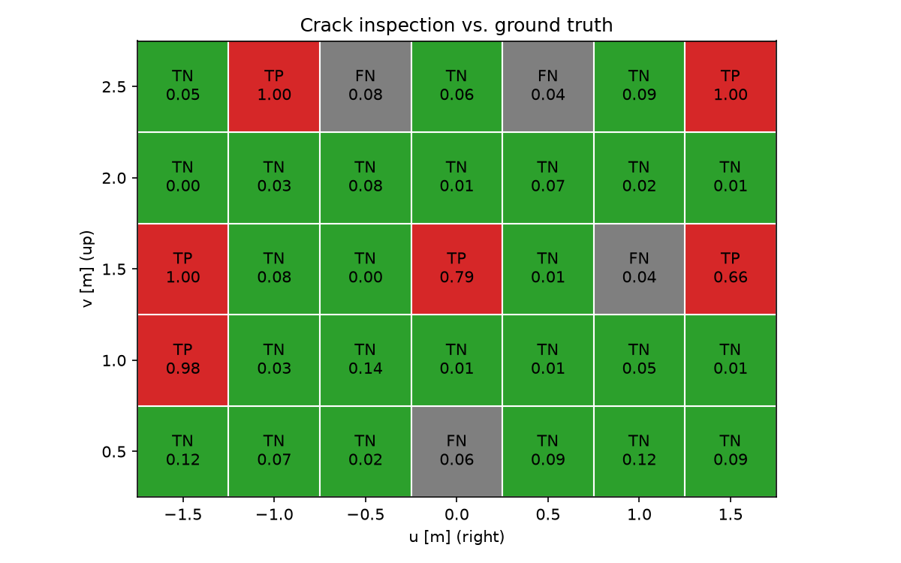
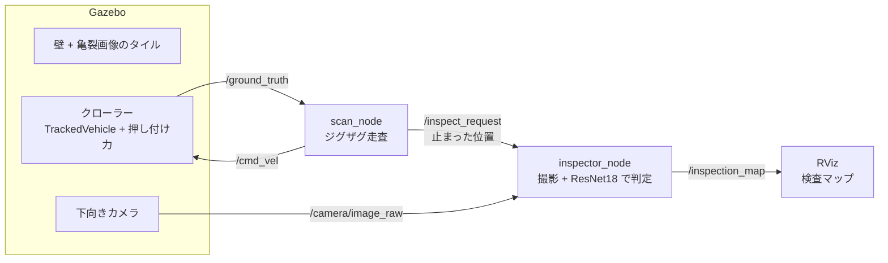

# 壁登りロボットによる壁面の亀裂検査（Gazebo + ROS 2 + 深層学習）

負圧吸着クローラー型の壁登りロボットがコンクリート壁をジグザグに走査し、
各マスで止まってカメラで撮影し、亀裂判定 AI（ResNet18）で亀裂の有無を判定して、
検査マップを RViz に表示します。最後に、壁の正解マップと比べて正解率を出します。

- 動画：https://youtu.be/ljaNR67aQqU



## 結果

| 評価 | 正解率 | 適合率 | 再現率 | F1 |
|---|---|---|---|---|
| SDNET2018 の test 画像（2,521 枚） | 0.935 | 0.836 | 0.841 | 0.838 |
| Gazebo の壁でロボットが撮影（35 マス） | 0.886 | 1.000 | 0.600 | 0.750 |

- 壁の 35 マスのうち亀裂は 10 マス。誤検出は 0 マス、見逃しは 4 マス（cell 3・19・30・32）でした。
  見逃した 4 マスは亀裂の確率が 0.04〜0.08 と低く、閾値を変えても拾えません。
- 走査：35 点すべてに到達しました（誤差 0.03 m 以内、約 221 秒）。
  行に沿って走るときの上下のずれは ±0.8 cm 以内で、重力によるずり下がりはほぼ見られませんでした。
- 詳細は `results/` を参照してください。
  - `crack_resnet18/`：画像単位の評価
  - `wall_map/`：壁での評価
  - `scan_trajectory/`：走行の記録

## 仕組み



| パッケージ / フォルダ | 内容 |
|---|---|
| `ros2_ws/src/wall_inspection_gazebo` | 壁のワールド、クローラーと壁タイルのモデル、ros_gz_bridge の設定 |
| `ros2_ws/src/wall_inspection_control` | `scan_node`（目標のキュー + 1 点への移動）、launch、RViz の設定 |
| `ros2_ws/src/wall_inspection_perception` | `inspector_node`（撮影・判定・検査マップの MarkerArray） |
| `src/robot_ai/ml` | データ分割、学習、評価、壁タイルの生成 |
| `src/robot_ai/analysis` | 走行の記録の解析、正解マップとの比較 |
| `results/` | 評価結果（JSON・CSV・図） |

主な工夫：

- **データリークの防止**：SDNET2018 の画像は 72 枚の元写真から切り出されたものなので、**元写真の単位**で train / val / test に分けました。
  壁に貼る画像には **test の画像だけ**を使っています。
- **カメラは車体の下の中心に、壁に向けて付けました**。ロボットがどちらを向いていても「ロボットの位置 = 撮るマス」になるため、
  走査のノードを変えずに済みます。
- 検査マップは `TRANSIENT_LOCAL` の QoS で配信しているので、後から起動した RViz にも届きます。

## 動作環境

次の環境で確認しました（ほかの環境では確認していません）。

- Windows 11 + WSL2（Ubuntu 24.04）+ Docker Desktop
- NVIDIA GeForce RTX 3050（VRAM 6 GB）
- コンテナの中：ROS 2 Jazzy、Gazebo Harmonic、Python 3.12、PyTorch（CUDA）

注意：

- 画面は WSLg に表示します。WSL ではない Linux での画面表示は確認していません。
- 学習には NVIDIA GPU を推奨します（GPU がなくても CPU で動きますが、とても遅くなります）。
- コンテナのビルドと学習の初回（ImageNet の事前学習済みの重み 約 45 MB）には、インターネット接続が必要です。

## セットアップ

【WSL の Ubuntu ターミナル】

```bash
git clone https://github.com/ponsan/wall-inspection-robot.git
cd wall-inspection-robot
./scripts/detect_gpu.sh          # WSL と GPU を判定して compose.override.yaml を作る
docker compose up -d --build
docker compose exec dev bash     # コンテナに入る
```

【コンテナ内のターミナル】

```bash
cd /workspace/ros2_ws
colcon build --symlink-install
source install/setup.bash
cd /workspace
```

終わるときは、【WSL の Ubuntu ターミナル】で `docker compose down` を実行します。

## 実行

### 1. データセットの準備

[SDNET2018](https://doi.org/10.15142/T3TD19) の `SDNET2018.zip`（約 500 MB）をブラウザでダウンロードして展開し、
次の形になるように置きます（`data/` は Git の管理外です）。

```text
data/raw/SDNET2018/W/CW/*.jpg   # 壁・亀裂あり（3,851 枚）
data/raw/SDNET2018/W/UW/*.jpg   # 壁・亀裂なし（14,287 枚）
```

### 2. 学習と評価

【コンテナ内のターミナル】（`/workspace` で実行）

```bash
python -m robot_ai.ml.split_sdnet                 # 元写真の単位で分割 → data/splits/sdnet_wall.csv
python -m robot_ai.ml.train_crack                 # ResNet18 を学習 → models/crack_resnet18/best.pt
python -m robot_ai.ml.evaluate_crack --split test # test 画像で評価 → results/crack_resnet18/
```

RTX 3050 で学習（10 エポック）は約 6 分でした。
seed は固定していますが、GPU の計算は完全には再現しないため、結果がわずかに変わることがあります。

### 3. 壁の走査と検査

【コンテナ内のターミナル】（`/workspace` で実行。重みのパスと保存先が `/workspace` からの相対パスのため）

```bash
ros2 launch wall_inspection_control scan.launch.py
```

Gazebo と RViz が開き、ロボットが 35 マスを順に検査します（約 4 分）。
検査したマスが RViz に緑（亀裂なし）か赤（亀裂あり）で表示されます。
撮影した画像と判定の結果は `data/inspection/` に保存されます。止めるときは Ctrl+C を押します。

`inspector_node` は PyTorch を使うので、launch では venv の Python で起動しています（`prefix='python3'`）。
単独で起動するときは、次のようにしてください。

```bash
ros2 run --prefix python3 wall_inspection_perception inspector_node
```

### 4. 正解マップとの比較

```bash
python -m robot_ai.analysis.compare_wall_map      # → results/wall_map/
```

### テスト

```bash
pytest                                                      # Python（src/）のテスト
cd ros2_ws && colcon test && colcon test-result --verbose   # ROS 2 パッケージのテスト
```

## 単純化した点と今後の課題

- **負圧吸着**は、壁に向かう一定の押し付け力（Gazebo の `ApplyLinkWrench`、500 N）で模擬しました。
  力の向きがワールド座標で固定なので、**平らな壁だけ**に対応しています。
- **ロボットの位置**には Gazebo の真値（`OdometryPublisher`）を使っています。クローラーのオドメトリは旋回で大きくずれたためです。
  IMU との統合（EKF）や SLAM は今後の課題です。
- 走査の経路はルールベース（ジグザグ + P 制御）です。AI を使っているのは亀裂の判定だけです。
- 壁での再現率（0.6）は画像単位の評価（0.84）より低くなりました。ただし壁の亀裂は 10 マスしかなく、
  カメラを通したことによるドメインの差なのか、ただの揺らぎなのかは、この結果だけでは判断できません。
- 今後の課題：打音による内部欠陥の検査と画像との統合、曲面・天井への対応、実機での検証。

## 出典・ライセンス

- このリポジトリのコード：Apache License 2.0（[`LICENSE`](LICENSE)）
- クローラーのモデル：Gazebo Sim の `tracked_vehicle_simple.sdf` を元に変更しました（Apache License 2.0。変更点は `model.sdf` の先頭に記載）。
  https://github.com/gazebosim/gz-sim
- 亀裂の画像（壁のテクスチャ）と学習データ：SDNET2018（CC BY 4.0）
  - Maguire, M., Dorafshan, S., & Thomas, R. J. (2018). SDNET2018: A concrete crack image dataset for machine learning applications.
    Utah State University. https://doi.org/10.15142/T3TD19
  - Dorafshan, S., Thomas, R. J., & Maguire, M. (2018). SDNET2018: An annotated image dataset for non-contact concrete crack detection
    using deep convolutional neural networks. *Data in Brief*, 21, 1664–1668. https://doi.org/10.1016/j.dib.2018.11.015
- 学習の初期値：torchvision の ImageNet 事前学習済み ResNet18
